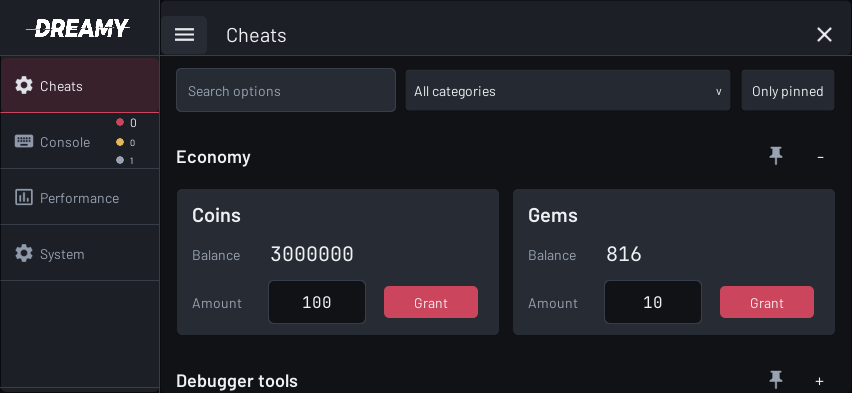
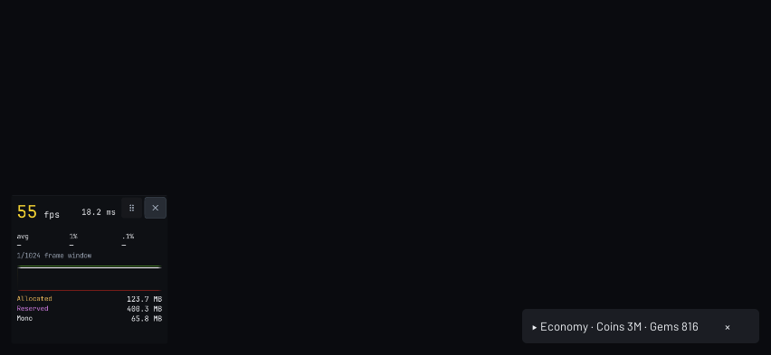
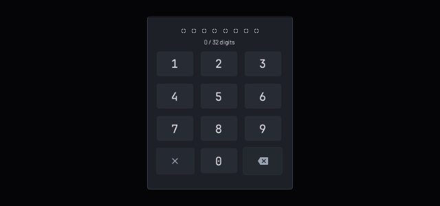
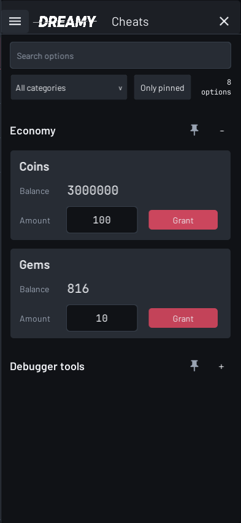
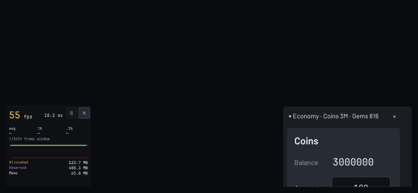
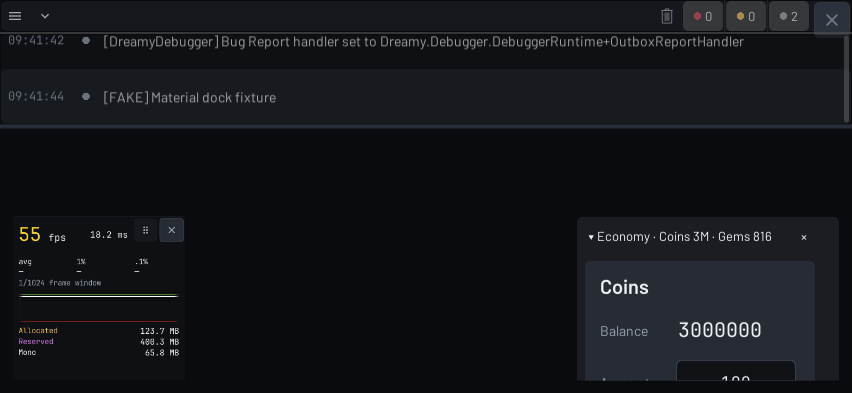

# Dreamy Debugger

**v0.1.4 · Dreamy Game Studio · Unity 6000.0+**

Debugger runtime độc lập cho Unity, gồm Console, cheat theo nhóm, Performance HUD, thông tin hệ thống và diagnostics. Hỗ trợ màn hình ngang/dọc và safe area; không cần Dreamy Core/UI hoặc cài Graphy riêng.

## Cài đặt và sử dụng

1. Package Manager → **+ → Install package from Git URL**:
   ```text
   https://github.com/Dreamy-Game-Foundation/com.dreamy.debugger.git#v0.1.4
   ```
   Với local package, chọn **Install package from disk** → `package.json`.
2. Chờ compile rồi nhấn **Play**. Mặc định debugger tự khởi động, không cần sample hoặc prefab trong scene.
3. **Tap 5 lần ở góc trên trái → nhập PIN `0000`**. Có thể mở từ **Window → Dreamy Debugger → Cheat Panel → Open cheat panel in Game view**.

## Tính năng chính

- **Console:** tìm kiếm, lọc severity, collapse, xem stack trace và copy log; hỗ trợ dock nổi.
- **Cheats:** bool, số, enum, string, read-only, button; tìm kiếm, ghim category và xác nhận thao tác. Có card tài nguyên và ownership.
- **Performance:** FPS, frame time, memory và lịch sử; HUD kéo được, chạm để đổi chế độ, nút × để tắt.
- **System & diagnostics:** thông tin build/thiết bị, report lưu cục bộ, screenshot tùy chọn và gửi Telegram qua relay.

## Giao diện

Ảnh render thật từ Unity trong bộ test v0.1.3, sử dụng dữ liệu giả lập; không phải ảnh chụp trên điện thoại thật.

**Cheats:** card tài nguyên, tìm kiếm/lọc, ghim category và sidebar đóng/mở.



| HUD và category đã ghim | Keypad nhập PIN |
|---|---|
|  |  |
| HUD kéo tự do, chạm vùng số để đổi chế độ, nút × để tắt; category ghim thu thành chip nhỏ. | Keypad căn giữa, hỗ trợ PIN dài; nút huỷ và xoá ký tự riêng biệt. |

<details>
<summary><strong>Cheats màn dọc — xem bố cục tự xuống hàng</strong></summary>

Sidebar đóng để dành chỗ cho nội dung; các card tài nguyên xếp dọc theo chiều rộng màn hình.



</details>

| Category ghim khi mở rộng | Console dock |
|---|---|
|  |  |
| Chạm chip để mở control; cuộn vùng ghim để xem phần bên dưới. | Ghim log nổi, lọc severity, thu gọn hoặc đóng dock; dùng chung nguồn log Console. |

## Setup trong project

### 1. Chọn cách khởi động

Mở **Window → Dreamy Debugger → Settings → Overview**:

| Loading mode | Cách dùng |
|---|---|
| **Automatic** (mặc định) | Play trong scene bất kỳ; package tự tạo runtime. Không cần import sample, đặt prefab hoặc gọi API khởi tạo. |
| **Manual** | Game quyết định thời điểm khởi tạo: thêm bootstrap vào startup scene bằng window, hoặc gọi `DebuggerBootstrap.Initialize(configuration)` từ game bootstrap khi đang Play. |

Runtime sống qua scene bằng `DontDestroyOnLoad`. Chỉ dùng một bootstrap; không đặt vào mọi scene. Bootstrap đã authored trong scene được ưu tiên kể cả inactive, disabled hoặc Mode Off; Automatic không tự bật thay nó. Không cần chạy Setup Theme hoặc rebuild assets để bắt đầu.

Nếu dùng Manual bằng code, gọi sau khi game đã vào Play:

```csharp
using Dreamy.Debugger;

// configuration là DebuggerConfiguration của project; truyền null để resolve defaults.
var runtime = DebuggerBootstrap.Initialize(configuration);
// runtime có thể null nếu Mode Off hoặc build policy không cho phép chạy.
```

### 2. Tạo configuration riêng

1. **Create → Dreamy → Debugger → Configuration** để tạo asset trong project.
2. Vào **Window → Dreamy Debugger → Settings**, gán asset vào **Project configuration**.
3. Chỉnh policy/defaults trên asset; Stop/Play lại hoặc build lại để áp dụng. Runtime clone configuration khi khởi tạo, không đọc lại policy từ asset mỗi frame.

Lựa chọn configuration lưu tại `ProjectSettings/DreamyDebuggerSettings.asset`; commit file này và asset/config `.meta` để các thành viên dùng cùng cấu hình. Nếu đã có bootstrap trong scene, kiểm tra configuration được gán trên bootstrap đó.

| Trường | Ý nghĩa / mặc định |
|---|---|
| `Mode` | `Development` mặc định; `Off` tắt runtime. `Development`/`Qa` chỉ khởi tạo trong Editor hoặc Development Build. `ReleaseDiagnostics` cho phép diagnostics ở build thường, không tạo panel/HUD và không cho chạy cheat. |
| `RequiredTaps`, `TapPosition` | Số tap và góc kích hoạt; mặc định **5 tap, góc trên trái**. |
| `Credential`, `Passphrase` | PIN mặc định **0000**; bật Passphrase nếu cần nhập chuỗi thay PIN. |
| `SessionSeconds` | Thời gian phiên unlock; mặc định 300 giây. |
| `ShowCornerTrigger` | Bật vùng nhận tap vô hình ở góc cấu hình. |
| `InitialHud`, `InitialHudPosition` | HUD mặc định Off, vị trí dưới trái. |
| `PersistRuntimePreferences` | Nhớ lựa chọn giao diện trên từng máy/thiết bị; preference đã lưu có thể ghi đè defaults HUD. |
| `AutoReportErrors`, `AllowScreenshots`, `UploadsEnabled` | Mặc định tắt; chỉ bật khi đã cấu hình reporting phù hợp. |

### 3. Kiểm tra lần đầu và tắt khi cần

1. Play → tap góc đã chọn đủ số lần → nhập PIN → mở được Console, Cheats, Performance và System.
2. Cheats chưa có option game là bình thường: game hoặc sample cần đăng ký container riêng.
3. Performance → chọn HUD; kéo vị trí, chạm vùng số để đổi chế độ, nút × để tắt.
4. Đóng panel chỉ đóng giao diện. Gọi `DebuggerRuntime.Instance?.Relock()` để khóa lại; phiên cũng khóa khi mất focus/pause.
5. Muốn tắt runtime: đặt **Mode = Off** trong configuration đang dùng rồi restart. Chọn **Manual** chỉ dừng tự khởi động, bootstrap authored vẫn có thể chạy.

## Thêm cheat option

### Cách 1: sửa sample để thử ngay

1. **Package Manager → Dreamy Debugger → Samples → Debugger Quick Start → Import**.
2. Unity chép source vào `Assets/Samples/Dreamy Debugger/0.1.4/Debugger Quick Start`. Sửa bản trong **Assets**, không sửa source package.
3. Play → 5 tap góc trái trên → PIN `0000` → Cheats có 8 control mẫu. Host tự đăng ký trong Editor/Development Build, không cần tạo scene demo hoặc gắn component.
4. Tạo file `ProjectCheats.Testing.cs` bên cạnh `ProjectCheats.cs`:

```csharp
using System.ComponentModel;
using Dreamy.Debugger.Options;

namespace Dreamy.Debugger.Sample
{
    public sealed partial class ProjectCheats
    {
        private bool showHitboxes;

        [Category("Testing"), DisplayName("Show hitboxes")]
        [CheatId("sample.show-hitboxes")]
        public bool ShowHitboxes
        {
            get => showHitboxes;
            set => SetValue(ref showHitboxes, value);
        }
    }
}
```

Stop/Play lại: category **Testing** có toggle **Show hitboxes**. `SetValue` có sẵn trong partial gốc và phát `INotifyPropertyChanged`. Toggle này chỉ sửa biến mẫu; muốn hiện hitbox thật phải nối setter với renderer/service của game.

Các partial phải cùng **class, namespace và assembly**. Không đăng ký thêm container vì sample host đã làm việc đó. Giữ asmdef và `link.xml` của sample. Sample chỉ sửa dữ liệu trong RAM, không tự sửa wallet, save hay `Time.timeScale` của game.

Sample import là bản sao, không tự cập nhật theo package. Backup/merge phần đã sửa khi nâng cấp; tránh giữ hai thư mục version cùng khai báo type `Dreamy.Debugger.Sample`. Khi chuyển sang integration game riêng, xóa sample hoặc bỏ host mẫu để tránh catalog demo và ID trùng.

### Cách 2: nối service game thật

Tạo container trong code project. Ví dụ dưới đây dùng interface adapter **do game tự triển khai**, không phải API wallet/player của package.

**`GameCheatOptions.cs`** — contract và container:

```csharp
using System;
using System.ComponentModel;
using Dreamy.Debugger.Options;
using Dreamy.Debugger.Presentation;

namespace MyGame.Debugging
{
    public interface IGameDebugService
    {
        bool GodMode { get; set; }
        long Coins { get; }
        void AddCoins(long amount);
        void ResetProgress();
    }

    public sealed partial class GameCheatOptions
    {
        private readonly IGameDebugService game;

        public GameCheatOptions(IGameDebugService game)
        {
            this.game = game ?? throw new ArgumentNullException(nameof(game));
        }

        [Category("Player"), DisplayName("God mode")]
        [CheatId("game.god-mode")]
        public bool GodMode
        {
            get => game.GodMode;
            set => game.GodMode = value;
        }

        [Category("Save"), DisplayName("Reset progress")]
        [CheatId("game.reset-progress"), CheatConfirmation]
        public void ResetProgress() => game.ResetProgress();
    }
}
```

**`GameCheatOptions.Economy.cs`** — thêm option bằng partial, không sửa host:

```csharp
using System.ComponentModel;
using Dreamy.Debugger.Options;
using Dreamy.Debugger.Presentation;

namespace MyGame.Debugging
{
    public sealed partial class GameCheatOptions
    {
        private const string CoinsCard = "game.coins";

        [Category("Economy"), ResourceCheat(CoinsCard, "Coins", CheatCardRole.Balance)]
        public long CoinBalance => game.Coins;

        [Category("Economy"), ResourceCheat(CoinsCard, "Coins", CheatCardRole.Amount)]
        [NumberRange(1, 1000000), Increment(100), Sort(1)]
        public long CoinAmount { get; set; } = 100;

        [Category("Economy"), ResourceCheat(CoinsCard, "Coins", CheatCardRole.Action)]
        public void AddCoins() => game.AddCoins(CoinAmount);
    }
}
```

Ba member tạo một resource card: balance chỉ đọc, amount chỉnh được và nút grant có xác nhận. Giữ cùng card ID/title/category và một member cho mỗi role. Service game chịu trách nhiệm grant/save, giới hạn nghiệp vụ và quyền truy cập; package chỉ hiển thị và gọi adapter.

**`GameCheatHost.cs`** — đăng ký theo vòng đời owner:

```csharp
using System;
using Dreamy.Debugger;
using UnityEngine;

namespace MyGame.Debugging
{
    public sealed class GameCheatHost : MonoBehaviour
    {
        private IDisposable lease;

        // Game bootstrap gọi sau khi service và debugger runtime đã sẵn sàng.
        public void Bind(IGameDebugService service)
        {
            Unbind();
            if (!isActiveAndEnabled) return;

            var runtime = DebuggerRuntime.Instance;
            if (runtime == null || !runtime.isActiveAndEnabled || runtime.Cheats == null)
                return; // Mode Off hoặc runtime chưa sẵn sàng.

            lease = runtime.RegisterCheats(new GameCheatOptions(service), "game");
        }

        public void Unbind()
        {
            lease?.Dispose();
            lease = null;
        }

        private void OnDisable() => Unbind();
        private void OnDestroy() => Unbind();
    }
}
```

Để nối ví dụ vào project:

1. Triển khai `IGameDebugService` bằng adapter gọi player/wallet/save services hiện có.
2. Gắn `GameCheatHost` vào GameObject owner của integration, ví dụ startup root.
3. Sau khi service sẵn sàng **và** runtime đã khởi tạo, game bootstrap gọi `host.Bind(adapter)`. Với Automatic, không giả định runtime đã có trong `Awake`; đợi `DebuggerRuntime.Instance` có `Cheats` rồi Bind. Với Manual, khởi tạo debugger trước khi Bind.
4. Nếu runtime chưa sẵn sàng, `Bind` ở ví dụ chỉ trả về, không tự retry. Bootstrap phải gọi lại sau khi runtime sẵn sàng. Sau khi disable/enable host hoặc thay runtime/service, cũng Bind lại.
5. Gọi `host.Unbind()` trước khi hủy service nếu service kết thúc trước host. Không đăng ký lại trong mỗi `Update`.

Nếu code game dùng asmdef, thêm references **Dreamy.Debugger.Runtime**, **Dreamy.Debugger.Engine** và **Dreamy.Debugger.Presentation** như sample. Không đưa `UnityEditor` vào assembly runtime.

### Quy tắc authoring và attribute

| Khai báo | Control / hành vi |
|---|---|
| Public property `bool` có setter | Toggle. |
| Public property số có setter | Ô số; dùng `NumberRange` và `Increment` để giới hạn/bước tăng. |
| Public property `enum` / `string` | Chọn enum / nhập text. |
| Getter-only hoặc private setter | Giá trị chỉ đọc. |
| Public `void` không tham số | Button; thêm `CheatConfirmation` để yêu cầu xác nhận. |
| `Category`, `DisplayName`, `Sort` | Nhóm, nhãn và thứ tự hiển thị. |
| `CheatId` | ID ổn định; giữ ID khi đổi tên member. ID phải duy nhất trong registry. |
| `Browsable(false)` | Ẩn public helper không muốn tạo control. |

Field, static member và method có tham số không được tạo control. Public helper nên private hoặc được đánh dấu `Browsable(false)`.

Nếu không có `CheatId`/card attribute, ID mặc định là `<prefix>.<MemberName>`. Resource card tự tạo `.balance`, `.amount`, `.grant`; `CheatId` ghi đè ID member nhưng không thay card ID. Không đăng ký cùng option bằng cả attribute và typed API.

Khi giá trị đổi từ gameplay, có thể triển khai `INotifyPropertyChanged` như sample để lease tự nhận notification, hoặc gọi `runtime.Cheats.NotifyValuesChanged()` trên owner thread sau khi service đổi. Không cần đăng ký lại container để refresh. Getter/setter nên nhẹ; getter lỗi sẽ hiển thị `Unavailable`.

Xem [CHEAT_OPTIONS](Documentation~/CHEAT_OPTIONS.md) cho ownership card, typed API và quy tắc registry.

### Giữ option trong build IL2CPP / stripping

Reflection cần giữ type/member. Tạo `Assets/Debugging/link.xml` cho container game, ví dụ:

```xml
<linker>
  <assembly fullname="Assembly-CSharp">
    <type fullname="MyGame.Debugging.GameCheatOptions" preserve="all" />
  </assembly>
</linker>
```

Nếu dùng asmdef, thay `Assembly-CSharp` bằng **name trong asmdef của game**. Đổi namespace/type thì sửa `fullname`. Partial không tạo type riêng nên chỉ cần giữ container một lần. Giữ `link.xml` của sample nếu vẫn dùng sample.

Trước khi giao build: bật **Development Build** khi dùng Development/Qa, kiểm tra mở PIN, control đọc/ghi đúng service, xác nhận grant/reset, disable owner thì option được gỡ và chạy thử trên build IL2CPP. Editor compile thành công không chứng minh reflection còn đủ sau stripping.

## Lỗi thường gặp

| Hiện tượng | Cần kiểm tra |
|---|---|
| Tap không mở | Loading mode, Mode/build policy, đúng góc và số tap; có bootstrap authored inactive/disabled chặn Automatic không. |
| Đổi configuration không có hiệu lực | Asset đang được chọn trong Settings/bootstrap, đã restart Play chưa; HUD có thể đang dùng preference đã lưu. |
| Panel mở nhưng Cheats trống | Đã import sample hoặc gọi Bind/RegisterCheats sau khi runtime/service sẵn sàng chưa. |
| Partial mới không hiện | Cùng namespace/class/assembly, member public và kiểu hỗ trợ; Stop/Play sau khi sửa. |
| Option trùng / lỗi ID | Hai bản sample đã import, hai host, đăng ký lại container hoặc ID trùng. |
| Cheat chỉ sửa số trên UI | Setter/action đang sửa model mẫu; nối adapter với service và đường save thật. |
| Editor có cheat, IL2CPP mất | `link.xml` giữ đúng assembly/type/member; kiểm tra build policy. |
| Không compile khi import Git bản 0.1.0 | Cập nhật 0.1.1 trở lên; không sửa PackageCache hoặc xóa `.meta` để chữa thiếu control scripts. |

## Lưu ý quan trọng

- Đổi PIN mặc định và kiểm tra build policy trước khi giao build. PIN/attribute không thay quyền truy cập hoặc xác thực server của game.
- Upload và screenshot tự động mặc định tắt. Muốn gửi Telegram, cấu hình relay; không đưa bot token vào client. Xem [reporting](Documentation~/REPORTING.md) và [cài relay](Tools~/relay/README.md).
- Chỉ cài một bản Dreamy Debugger; giữ nguyên `.meta`/GUID khi nâng cấp. Không cần Setup Theme hoặc rebuild assets để dùng.
- Ảnh và kết quả kiểm tra trong Unity không thay kiểm thử thiết bị thật, IL2CPP hoặc hiệu năng production. Xem [phạm vi kiểm chứng](Documentation~/RELEASE.md) và [hỗ trợ nền tảng](Documentation~/PLATFORM_SUPPORT.md).

## Tài liệu

[Migration](Documentation~/MIGRATION.md) · [Changelog](CHANGELOG.md) · [Acceptance](Documentation~/ACCEPTANCE.md)

Package dùng nội bộ; giữ license và điều kiện upstream.
